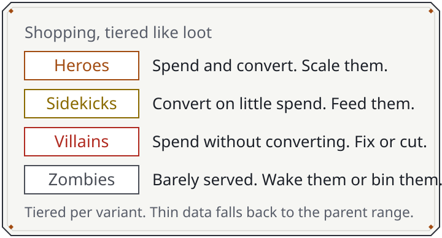
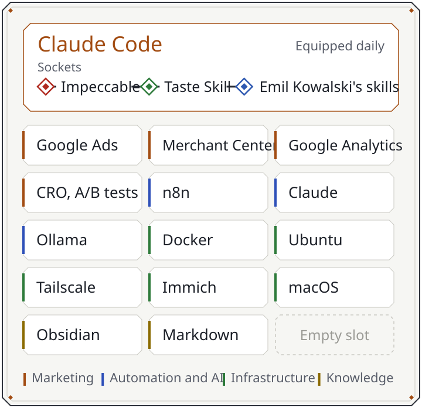
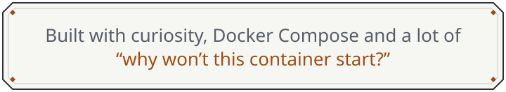

<picture>
  <source media="(prefers-color-scheme: dark)" srcset="assets/banner-dark.svg">
  <source media="(prefers-color-scheme: light)" srcset="assets/banner-light.svg">
  
</picture>

  <a href="https://www.linkedin.com/in/ellisosborn/"><b>LinkedIn</b></a>
  &nbsp;·&nbsp; Based in the UK

<h3>
<picture>
  <source media="(prefers-color-scheme: dark)" srcset="assets/h-backstory-dark.svg">
  <source media="(prefers-color-scheme: light)" srcset="assets/h-backstory-light.svg">
  
</picture>
</h3>

I spent my career in ecommerce and digital marketing, most recently as **Head of Ecommerce**. The best parts were the autonomy, shipping features a CRO test had already proven, and arguing about PPC strategy.

In 2026 I stepped away from office life, spent most of the year travelling in Asia, and came back wanting to **build things I own**.

Not a developer. Building anyway. I learn by doing, with AI as a pair-programmer: Claude Code every day, with Impeccable, Taste Skill and Emil Kowalski's skills as the design kit. This GitHub is where the work lives.

Trained at: BA Business Marketing & Management, University of East Anglia.

<h3>
<picture>
  <source media="(prefers-color-scheme: dark)" srcset="assets/h-quests-dark.svg">
  <source media="(prefers-color-scheme: light)" srcset="assets/h-quests-light.svg">
  
</picture>
</h3>

**Active**

- **Own ecommerce brand.** Test-led product validation. Every idea gets scored, gets a small ad budget, and gets kill/scale rules before it gets a penny.
- **Google Ads rebuilds.** Messy legacy accounts in, clean structures out. Search gets consolidated. Shopping gets tiered by performance at variant level, with the parent range as the fallback when a product hasn't earned enough data. The Merchant Center feed gets cleaned up on the way through.

  <picture>
    <source media="(prefers-color-scheme: dark)" srcset="assets/loot-filter-dark.svg">
    <source media="(prefers-color-scheme: light)" srcset="assets/loot-filter-light.svg">
    
  </picture>

- **Marketing automation.** n8n in Docker Compose, doing the repetitive parts of ecommerce and ad ops so I don't have to.
- **Offline-first knowledge vault.** Obsidian, synced to my own server, plus an offline library for when the internet isn't there.
- **AI agents.** Claude skills, project-based bots and self-hosted agents.

**Completed**

- **Forever Codex.** A companion dashboard for WoW: Forever, built while I wait for it. Sim DPS tier lists, class and race comparisons, spec guides, gear, raids and levelling. It refreshes daily and runs its own data-consistency checks.
- **Left Google Photos.** About 48,000 photos and videos out of Takeout and onto my own server.
- **Cleared the "up next" list.** Everything on it is built and running.

<h3>
<picture>
  <source media="(prefers-color-scheme: dark)" srcset="assets/h-bank-dark.svg">
  <source media="(prefers-color-scheme: light)" srcset="assets/h-bank-light.svg">
  
</picture>
</h3>

The homelab. In RuneScape, the bank is where everything you own lives. Mine keeps my photos, runs AI locally and holds a library that works without the internet.

Every service I deploy gets its own written guide, including what broke and how I fixed it.

<h3>
<picture>
  <source media="(prefers-color-scheme: dark)" srcset="assets/h-inventory-dark.svg">
  <source media="(prefers-color-scheme: light)" srcset="assets/h-inventory-light.svg">
  
</picture>
</h3>

<picture>
  <source media="(prefers-color-scheme: dark)" srcset="assets/inventory-dark.svg">
  <source media="(prefers-color-scheme: light)" srcset="assets/inventory-light.svg">
  
</picture>

<h3>
<picture>
  <source media="(prefers-color-scheme: dark)" srcset="assets/h-offclock-dark.svg">
  <source media="(prefers-color-scheme: light)" srcset="assets/h-offclock-light.svg">
  
</picture>
</h3>

Photography, food, travel, and the Scottish Highlands in a campervan.

**Playing:** Old School RuneScape, Path of Exile 1 and 2. 
**Queued:** WoW: Forever. The countdown is why Forever Codex exists.

 

<picture>
  <source media="(prefers-color-scheme: dark)" srcset="assets/footer-dark.svg">
  <source media="(prefers-color-scheme: light)" srcset="assets/footer-light.svg">
  
</picture>
